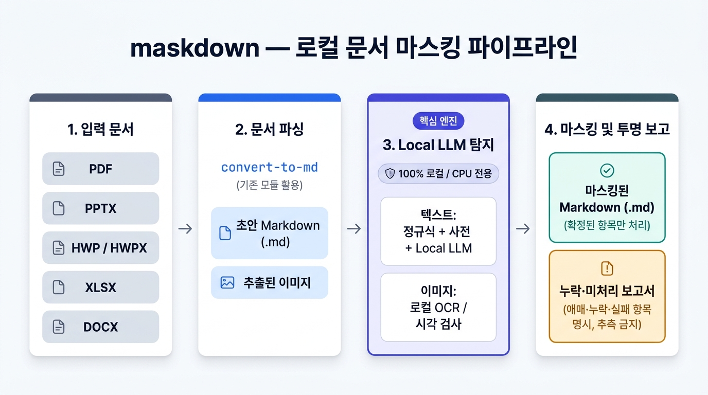

# maskdown

> **고객사 문서(PDF, PPT, HWP, Excel, DOCX)의 텍스트·이미지 속 중요 정보를 100% 로컬 LLM 모델 기반으로 탐지·마스킹하고 Markdown(`.md`)으로 변환하는 도구**

---

## 1. 목적

고객사 문서를 사내 지식베이스(RAG)나 AI 워크플로우에 활용하려면 개인정보, 기업명, 시스템·계약 정보 등 민감 데이터를 먼저 제거해야 합니다.  
`maskdown`은 **외부 API 전송 없이** 일반 업무용 PC(16GB RAM, GPU 없음)에서 안전하게 문서를 비식별화하고 Markdown으로 정제하는 로컬 파이프라인을 목표로 합니다.

---

## 2. 처리 파이프라인

* **문서 파싱**: 기존 `inzent_ax/Project/skill/convert-to-md`에 구현된 변환 로직을 재활용합니다.
* **핵심 개발 범위**: 파싱 이후 단계인 **① 텍스트·이미지 속 중요 정보 탐지**와 **② 마스킹 방식 및 투명한 한계 보고**에 집중합니다.
* **투명한 실패·불확실성 보고 원칙 (추측 금지)**:
  * AI가 억지로 추측해 잘못된 마스킹을 수행하지 않도록, **확신할 수 없는 항목·파싱/인식 실패 영역·누락 가능 구간은 처리하지 않고 "처리 불가 / 애매함"으로 명명백백히 보고**합니다.
  * 최종 결과물은 **마스킹된 Markdown(`.md`)**과 함께 **애매·누락·미처리 항목 리포트**를 반드시 동반합니다.

---

## 3. 타깃 실행 환경

| 항목 | 구성 |
| :--- | :--- |
| **타깃 하드웨어** | 일반 업무용 PC (16GB RAM, GPU 없음 / CPU 전용) |
| **로컬 런타임** | Python 3.12+, Ollama (3B~4B급 Q4 양자화 모델 기준) 또는 경량 ONNX 모델 |

---

## 4. 팀 논의 및 서칭 항목

본격 구현 전, 팀원들과 아래 4가지 영역을 서칭하고 기준을 확정합니다.

### ① 중요 정보(마스킹 대상) 범위 정의
* **필수 대상**: 개인정보(성명, 연락처, 이메일, 주민번호 등) vs 기업·프로젝트 기밀(고객사명, 프로젝트명, 내부 IP/도메인, 시스템명, 계약 금액, 조직도 등)
* **예외(화이트리스트)**: 공개 기술 용어, 일반 제품명, 마스킹하면 문맥이 망가지는 도메인 용어 기준

### ② 텍스트 내 중요 정보 탐지 방식
* **탐지 조합**: 규칙(정규식) + 고객사 사전 + 로컬 LLM/NER의 역할 분담
* **로컬 모델 선정 (CPU 환경 벤치마크)**:
  * 경량 로컬 LLM (`qwen2.5:3b`, `qwen3:4b`, `exaone3.5:2.4b` 등) — 문맥 이해 강점, JSON 추출 방식(원문 재작성 금지)
  * 한국어 경량 NER 모델 (KLUE-RoBERTa / KoELECTRA ONNX 등) — 초고속·저메모리 강점
* **성능 기준**: 누락 최소화(높은 재현율) vs 오탐 허용 범위, 문서당 허용 처리 시간

### ③ 이미지 내 중요 정보 탐지 및 처리 방식
* PDF·PPT·HWP·DOCX에 포함된 **캡처 화면, 아키텍처 도식, 조직도, 도장/서명, 스캔 페이지** 처리 전략 비교:
  * **방안 A (제외)**: MD 변환 시 이미지를 일괄 제거하고 텍스트만 활용
  * **방안 B (로컬 OCR)**: `RapidOCR` / `PaddleOCR` 등 CPU용 OCR로 이미지 내 텍스트를 추출해 마스킹
  * **방안 C (이미지 마스킹)**: 민감 영역 좌표 탐지 후 블러/블랙박스 처리하여 이미지 유지
* CPU 전용 환경에서의 OCR 정확도·속도 테스트 및 인식 실패 이미지의 미처리 보고 기준

### ④ 마스킹 방식 및 애매·누락 항목 보고 체계
* **치환 포맷**: 문맥 유지를 위한 일관된 가명화 태그(`[고객사_1]`, `[담당자_1]`) vs 단순 마스킹(`***`)
* **불확실·미처리 기준 (신뢰도·안전 실패 기준)**: AI가 임의로 처리하지 않고 **"못했다 / 확인 필요"**로 분류해 반환할 판단 기준(신뢰도 임계값, OCR 저품질, 표/이미지 깨짐 등)
* **검수 리포트 포맷**: 치환 완료 목록과 별도로 **애매한 항목·누락 의심 구간·처리 실패 위치(페이지/문단/이미지)**를 명확히 분리해 출력하는 구조
* **메타데이터 정책**: PPT 발표자 노트, Excel 숨김 시트·메모, 문서 작성자 정보 처리 기준
